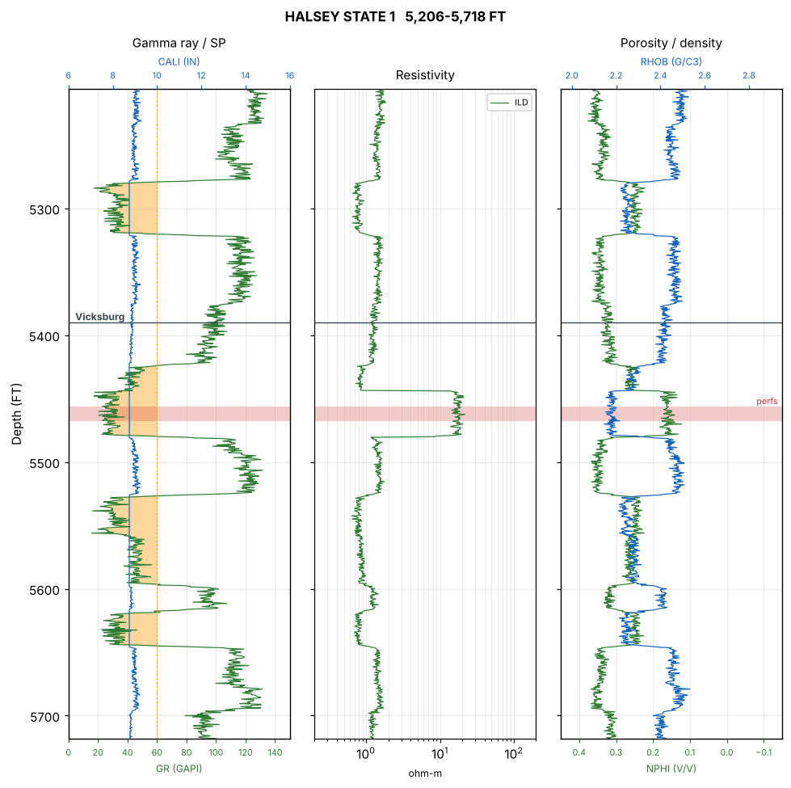

# Legacy Well Log Assistant

An AI assistant for legacy well data. It answers plain-language questions about LAS logs and completion reports, computes exact curve statistics, and draws standard log displays.

Operators sit on decades of well files: LAS logs digitized from paper, typed completion reports, header blocks nobody has read in years. This project lets you ask about them directly:

- *What curves were run on this well, and when was it logged?* → searched from LAS headers and reports, with citations
- *What's the average deep resistivity across the Anahuac in the Kubena 2?* → computed from the curve data, not guessed
- *Show me the log around the perforations.* → a GR/SP, resistivity and porosity display with tops and perfs marked
- *Which wells have the cleanest Anahuac sand?* → the same curve compared across every well



## How it works

The LLM handles language. Python handles numbers. An agent loop connects them.

```
                        ┌─ search_documents ─ hybrid RAG over headers + reports (BM25 + embeddings, RRF)
question ─ LLM agent ───┼─ curve_stats ────── exact interval / formation statistics from LAS arrays
   ▲                    ├─ compare_wells ──── one curve across wells for a formation
   │                    ├─ plot_log ───────── log display with tops and perforations
   │                    └─ list_wells ─────── wells, curves, depth ranges, tops
   └──── tool results ──┘  → cited answer + plot
```

- **Why tools, not just RAG.** Curve data is thousands of numbers per well. Pasted into a prompt it would run to hundreds of thousands of tokens, and an LLM averaging digit fragments in its head produces confident, wrong numbers. Instead, `lasio` loads curves as NumPy arrays and the LLM calls functions that compute exact values.
- **Document RAG.** LAS header sections (well info, curve list, parameters, curve statistics) and report paragraphs are chunked, then retrieved with BM25 plus dense embeddings fused by reciprocal rank fusion. A well-name router keeps retrieval to the well a question names.
- **Formation-aware.** Formation tops and perforations are parsed from completion reports, so tools accept `formation="Frio"` as well as explicit depths.
- **Grounded answers.** The system prompt requires the model to compute every curve number with a tool, cite document facts as `[doc N]`, and say when the tools can't answer.
- **Pluggable LLMs.** Claude through the Anthropic API, or any tool-capable local model through Ollama.

## Quick start

```bash
git clone https://github.com/SAnderwald/legacy-well-rag.git
cd legacy-well-rag
python -m venv .venv && source .venv/bin/activate
pip install -e ".[embeddings,llm,dev]"

python scripts/make_synthetic_data.py              # 15 synthetic wells -> data/synthetic/
wellrag ingest data/synthetic --embedder minilm    # builds ./index (use tfidf offline)
wellrag plot "Kubena 2" --top 7300 --base 7700     # log display, no LLM needed
```

Ask the agent:

```bash
export ANTHROPIC_API_KEY=...
wellrag chat "Show me the Kubena 2 from 7,300 to 7,700 ft and give the average ILD in the perforated interval" --show-tools

ollama pull llama3.1:8b                            # or fully local
wellrag chat "Compare the average GR in the Frio across all wells" --backend ollama
```

Web app (Shiny for Python):

```bash
shiny run app.py
```

- **Data tab:** type or pick (from recent folders) any project folder of LAS files and click **Load folder**. Subfolders are included. A table lists every file with its well, operator, field, UWI, curves, depth range, and how many tops and perforations were found; unreadable or duplicate files are listed separately. Switch between projects without restarting.
- **Assistant tab:** **Ask** sends the question to the agent (Ollama or Claude). **Plot** reads the well and depths from the question and draws the log instantly with no LLM. A tool-call table shows what the agent did.

Plain document Q&A without tools is still available: `wellrag ask "..." --backend none` shows exactly which excerpts retrieval returns.

Well names come from a random seed; see `data/synthetic/questions.jsonl` or `wellrag plot` errors for the names in your data.

## Synthetic data

`scripts/make_synthetic_data.py` builds geologically plausible logs rather than noise: random sand and shale beds drive GR, SP, resistivity, neutron and density together, and the perforated interval is a hydrocarbon-bearing sand (high resistivity, neutron-density crossover). Curve suites follow each well's logging era: SP and normal resistivities before 1960, induction plus GR through the 1970s, and neutron-density after. Each well also gets a completion report with formation tops, perforations, IP test and drilling problems.

All wells, operators, fields and UWIs are invented.

## Evaluation

The generator also writes 75 labeled questions (5 per well) naming the file and section that holds each answer.

```bash
wellrag eval data/synthetic/questions.jsonl --k 5
```

Document retrieval on the synthetic set with the TF-IDF fallback embedder:

| retrieval | hit@1 | hit@5 | mrr |
|---|---|---|---|
| bm25 | 0.88 | 1.00 | 0.93 |
| dense (TF-IDF) | 0.51 | 1.00 | 0.69 |
| hybrid | 0.63 | 1.00 | 0.80 |

On questions built around exact identifiers (well names, mnemonics, header fields), keyword search is hard to beat, and a weak embedder pulls hybrid down at rank 1. Every mode puts the right section in the top 5. Rerun with `--embedder minilm` to measure a real sentence-embedding model.

The test suite (`pytest -q`) checks that curve statistics match NumPy exactly, that tops and perforations parse, that the pay sand reads resistive, and that the agent loop executes tool calls and returns their results to the model (using a scripted stand-in for the API).

## Using real data

Point `wellrag ingest` at any folder of `.las` files plus optional `.txt` or `.md` reports. Public LAS files are available from state surveys such as the Kansas Geological Survey. Tops and perforations are read from report lines like `Frio: 7,820 ft` under a `FORMATION TOPS` heading and `Perforated the Frio from 7,500 to 7,508 ft`; adapt the patterns in `wellrag/logs.py` to your report formats.

## Project layout

```
wellrag/logs.py       LAS curve arrays, tops, perforations, curve_stats, compare_wells, plot_log
wellrag/agent.py      tool definitions and the Claude / Ollama tool-calling loop
wellrag/ingest.py     LAS header and report chunking
wellrag/index.py      embeddings, BM25, RRF fusion, well-name routing, save/load
wellrag/llm.py        plain RAG prompt and backends
wellrag/evaluate.py   hit@k and MRR evaluation
wellrag/cli.py        wellrag ingest | ask | chat | plot | eval
app.py                Shiny for Python app
scripts/make_synthetic_data.py   synthetic logs, reports and labeled questions
tests/                pytest suite
```

## Roadmap

- Computed petrophysics tools: Vshale from GR, density porosity, Archie water saturation, net pay with cutoffs
- Zone-summary chunks so document search can answer "which wells have a clean, resistive Frio sand?"
- Curve-shape embeddings (autoencoder on log windows) for "find intervals that look like this one"
- Answer-level evaluation of the agent (were the right tools called, are numbers correct)

## License

MIT
